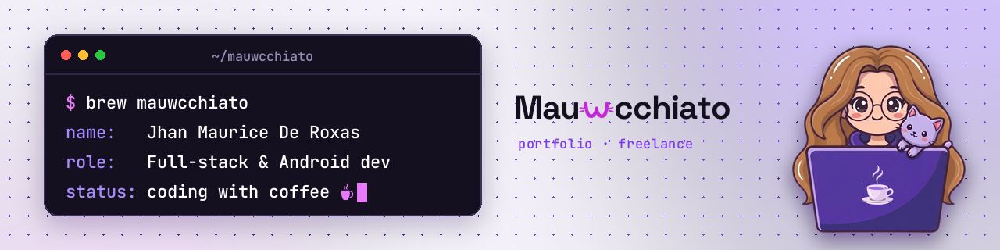

### Hi, I'm Jhan Maurice

Mau to most people, Mauwcchiato online. I'm from Cabuyao, Laguna. I build Android apps, web systems and small IoT devices, and I like the part where they all talk to each other. Usually with a coffee nearby, and a cat if I'm lucky.

**Portfolio:** [mau-jhan-portfolio.vercel.app](https://mau-jhan-portfolio.vercel.app) · **LinkedIn:** [jm-de-roxas](https://www.linkedin.com/in/jm-de-roxas-42aa5530a/) · **Email:** jhanmauricederoxas@gmail.com

---

### Things I've built

| Project | What it is | Built with |
|---|---|---|
| [**Kusina Kode**](https://github.com/mauwcchiato/kusina-kode-app) | A Filipino dish word puzzle for Android, with an admin site. | Kotlin, Jetpack Compose, PHP, MySQL, Azure |
| **D.I.L.I.G.** | A family plant-watering system: sensors, a gateway, a REST API and an Android app. | Arduino, ESP8266, PHP, MySQL, Kotlin |
| **BNK WMS** | A live booking and RFID check-in system for a pet grooming shop. I led the prototype and co-authored the build. | PHP, MySQL, RFID, Figma |
| **PulsePoint** | Clinic appointment scheduling for patients, doctors and secretaries. | ASP.NET, C#, SQL Server |
| **Cloud diagrams** | AWS and Azure architecture, network and security diagrams. | AWS, Azure, draw.io |

More, with screenshots and walkthrough videos, on the [portfolio](https://mau-jhan-portfolio.vercel.app/#projects).

### Tools I use

`Kotlin` `Jetpack Compose` `PHP` `MySQL` `JavaScript` `C#` `ASP.NET` `Python` `Arduino` `AWS` `Azure` `Figma` `Git`

### Right now

- Polishing Kusina Kode
- Learning more about cloud, networking and security
